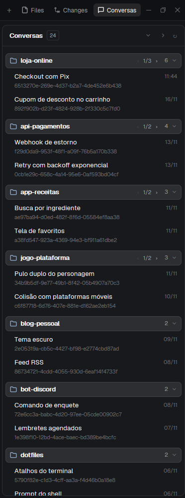
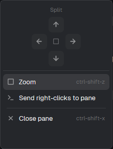
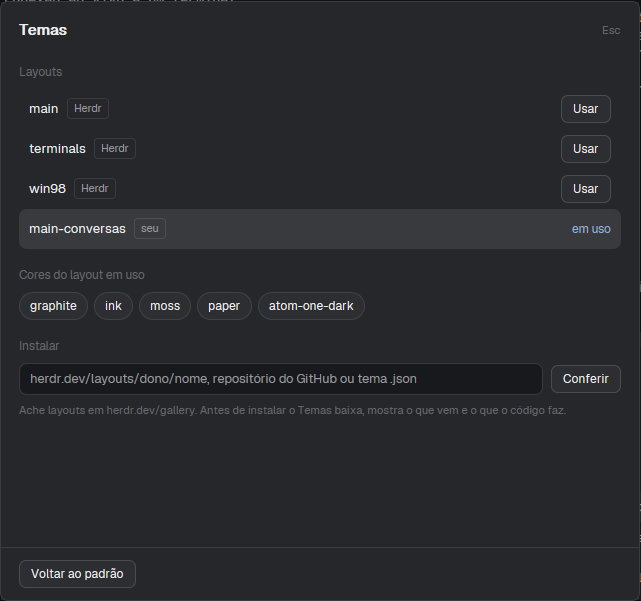
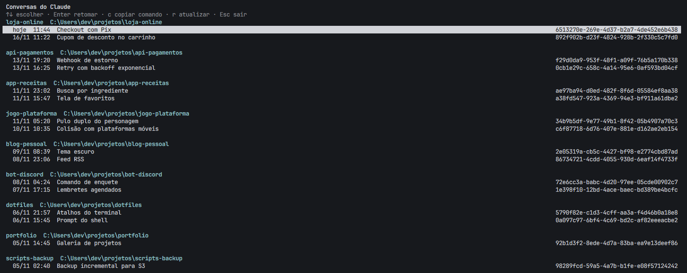

# herdr-mods

Mods para o [Herdr](https://herdr.dev), no app desktop (herdr-app) e no herdr de terminal.

| Peça | Onde | O que faz |
|---|---|---|
| `mods/conversas` | herdr-app | Painel **Conversas** à direita, junto de Files e Changes: as 2 últimas conversas do Claude Code de cada pasta, com título, hora e ID, e o tamanho em disco de cada pasta. Clique retoma a conversa; botão direito copia o comando; o ícone de página abre um modal com as últimas falas, com um botão que inverte a ordem (a escolha vale para todos os modais); o lápis renomeia a conversa; o campo do topo pesquisa por título, pasta ou ID; com mais de um computador no Herdr, botões trocam para as conversas do outro. |
| `mods/tabs-conversas` | herdr-app | Clone da barra de abas do Herdr com o botão **Conversas** ao lado de Files e Changes. |
| `mods/menu-split` | herdr-app | Clone do menu de botão direito do terminal com um direcional de split (↑ ← → ↓), como num controle. |
| `mods/temas` | herdr-app | Janela **Temas**: usa, instala (de herdr.dev, GitHub ou um tema `.json`) e apaga layouts e temas de cor, e volta ao padrão. |
| `mods/chrome-temas` | herdr-app | Clone do cabeçalho e do rodapé da barra lateral com o item **Temas** abaixo de Settings. |
| `mods/spaces-icones` | herdr-app | Clone da lista de espaços: na barra lateral minimizada, o avatar colorido de cada espaço no lugar do número. |
| `mods/agents-icones` | herdr-app | Clone da lista de agentes: na barra lateral minimizada, o ícone do agente e a bolinha de status no lugar do número, sem nome nem tempo (o nome fica na dica ao passar o mouse). Agentes de máquina remota ganham uma faixa à esquerda na cor da máquina, escolhida no quadradinho do cabeçalho dela na lista de espaços. |
| `mods/workspace-status-nomes` | herdr-app | Clone da barra de status com o nome da máquina do espaço (Windows, Mac) no lugar de "This computer" e do nome em minúsculas. |
| `mods/files-rapido` | herdr-app | Clone do painel Files que lista as pastas no Windows com `cmd` + `dir` (~0,15 s) em vez de um PowerShell por pasta (~2 s). |
| `layouts/main-conversas.json` | herdr-app | Clone do layout `main` que usa os mods acima. |
| `tui/` | herdr de terminal | Plugin `herdr-conversas`: popup com as mesmas conversas, aberto por atalho. |

## Como fica

**Painel Conversas** no herdr-app, ao lado de Files e Changes: cada pasta mostra 2 conversas por
página (`‹ 1/5 ›`), e as setas do cabeçalho expandem ou recolhem todas.



**Menu do botão direito** no terminal, com o direcional de split: a seta divide para aquele lado.



**Janela Temas**, aberta pelo item Temas da barra lateral ou por `ctrl-shift-y`:



**Popup do herdr de terminal** (`prefix+m`), com a pasta, a data, o título e o ID de cada conversa:



As pastas e conversas dos prints são fictícias.

Retomar uma conversa roda, na pasta onde ela aconteceu:

```sh
claude --dangerously-skip-permissions --resume <id>
```

Abre uma aba no space (ou workspace) que já está nessa pasta; se não houver, cria um.

## Instalar

Requisitos: Python 3 e o herdr-app aberto pelo menos uma vez (ele cria `~/.config/herdr-app`).

```sh
git clone git@github.com:n1mb3/herdr-mods.git
cd herdr-mods
python3 instalar.py
```

O `instalar.py` copia `mods/` e `layouts/` para `~/.config/herdr-app` (ou `$HERDR_APP_HOME`)
e liga o plugin `tui/` no herdr de terminal com
`herdr plugin link`. Depois de um `git pull`, rode de novo.

### No herdr-app

Troque para o layout **main-conversas** (`ctrl-shift-l` alterna os layouts, ou
`herdr-app do layout.switch --name main-conversas`).

**Ctrl+V com imagem no Windows:** o `terminal.paste_image` do Herdr no Windows só cola texto, e
o Claude Code no Windows lê a imagem do clipboard pelo Alt+V. Para o Ctrl+V colar imagem
também, troque no `keys.json` do app, seção `terminal`:

```json
"ctrl-v": "tabs-conversas.colar"
```

Com texto no clipboard (ou num terminal de outra máquina) ele faz o mesmo de antes; num
terminal local com só uma imagem, manda Alt+V ao programa. No Linux e no Mac não precisa: lá o
Ctrl+V já vai ao programa.

### No herdr de terminal

O atalho fica no `config.toml` do herdr (`herdr --help` mostra o caminho):

```toml
[[keys.command]]
key = "prefix+m"
type = "plugin_action"
command = "herdr-conversas.abrir"
description = "conversas do Claude"
```

No Windows, use `command = "herdr-conversas.abrir-windows"`: lá o Python se chama `python`, e
não `python3`, e o herdr não aceita a mesma ação com outro comando por sistema.

Depois, `herdr config check` e `herdr server reload-config`. No popup: `↑` `↓` escolhem,
`Enter` retoma, `c` copia o comando, `r` atualiza, `Esc` fecha.

## Temas

Abra pelo item **Temas** da barra lateral, abaixo de Settings, ou por `ctrl-shift-y` (no
`keys.json` do app: `"ctrl-shift-y": "mod.open:temas"` em `global`, que vale em qualquer layout).
A tela de Settings do Herdr não aceita seção nova: ela é regravada pelo app a cada abertura.

- **Usar**: troca de layout; os chips de cor aplicam o tema ao layout em uso.
- **Instalar**: cole `herdr.dev/layouts/<dono>/<nome>`, um repositório do GitHub ou a URL de um
  tema `.json` e clique em Conferir. O Temas baixa, mostra o que vem (layout, mods, cores,
  tamanho) e avisa se o código roda programas, acessa a rede ou lê arquivos fora da pasta. Nada
  é copiado antes do Instalar. Nome que já existe é recusado.
- **Apagar**: só aparece no que o Temas instalou, e remove exatamente os arquivos que ele
  copiou, inclusive os atalhos do layout no `keys.json`. Layouts e cores do Herdr e os seus
  (como `main-conversas`) nunca são apagados por ali.
- **Voltar ao padrão**: layout `main-conversas` (ou `main`) e as cores graphite e paper.

O registro do que foi instalado fica em `~/.config/herdr-app/.temas/registro.json`, e o motor é
o `mods/temas/temas.py` (`listar`, `inspecionar`, `instalar`, `remover`).

**Tirar o Temas do app:** no `layouts/main-conversas.json`, volte os blocos `brand` e
`sidebar-footer` para `"mod": "workspace-chrome"` e o rodapé para `{"px": 69}`; apague
`mods/temas` e `mods/chrome-temas` em `~/.config/herdr-app` e o `ctrl-shift-y` do `keys.json`.

## Como funciona

- As conversas vêm de `~/.claude/projects/<pasta>/<id>.jsonl` (um arquivo por conversa; o nome é
  o ID). O título é o `aiTitle` que o Claude Code grava; sem ele, o primeiro pedido.
- `mods/conversas/conversas.py --listar` imprime a lista em JSON; o mod do app chama esse modo a
  cada 30 s. O popup do herdr de terminal é o mesmo script, sem `--listar`.
  O JSON sai com escapes `\uXXXX` porque o stdout de um pipe no Windows é cp1252.
- `conversas.py --ultimas <id>` devolve as 12 últimas falas de texto da conversa (pedidos e
  respostas, sem ferramentas nem pensamento), lendo o `.jsonl` de trás para frente; o modal
  do ícone de página chama esse modo. A ordem escolhida no botão do modal fica em
  `shared("conversas.falasInvertidas")`, porque cada modal aberto ganha um `localStorage` próprio.
- Nas conversas de outra máquina, o painel manda o próprio `conversas.py` para lá como
  `python3 -c <script>` pelo herdr-core dela (`exec` com `on`): basta o Python 3 lá, sem
  instalar o herdr-mods. Retomar abre a aba num espaço daquela máquina.
- `conversas.py --renomear <id> <nome>` grava o nome como o `/rename` do Claude Code: uma linha
  `{"type":"custom-title",…}` no fim do `.jsonl`, que o `claude --resume` também mostra.
- O herdr-app só divide painéis para a direita e para baixo. **Split left** e **Split up** dividem
  para o outro lado e trocam os dois painéis de lugar.
- `tabs-conversas` e `menu-split` são clones de mods do Herdr 0.1.16, e `spaces-icones`,
  `agents-icones` e `files-rapido` do 0.1.18: os originais são
  substituídos a cada atualização do app, os clones não, então não recebem as novidades dos
  originais.

## Cuidado ao abrir o herdr-app

Abrir o herdr-app de dentro de uma sessão do Claude Code faz o app e o herdr-core herdarem
`NO_COLOR=1` e `CLAUDE_CODE_CHILD_SESSION=1`: a status line perde as cores e as conversas abertas
no app deixam de ser gravadas. Abra pelo menu Iniciar ou pelo lançador do sistema.
