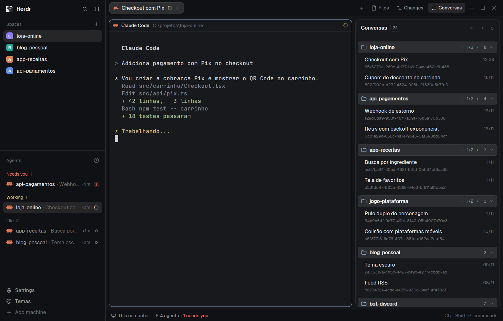

# Main + Conversas

Herdr's main window with your Claude Code history beside the terminals. A
**Conversas** panel, next to Files and Changes, lists the latest conversations
of every folder with their title, time and ID; a click resumes one in that
folder. Right-clicking a terminal gives a four-way split pad, and a **Temas**
dialog under Settings uses, installs and deletes layouts and color themes.

This file is the brief: enough to build Main + Conversas from an empty folder.
The files next to it are one build of it. If they don't work on your Herdr, or
you want it different, build it again from here. The UI text is in Portuguese
(Conversas, Expandir todas, Temas, Voltar ao padrão).

## What you see

Herdr's `main` layout (0.1.16), unchanged except for seven things:

1. **The Conversas panel**, on the right of the terminals, 368px wide, in the
   same card style as Files and Changes (10px radius, 1px border).
   - Header, 42px: "Conversas", a small boxed count of all conversations, then
     three 22px icon buttons: Expandir todas (chevron down), Recolher todas
     (chevron right) and ↻ (refresh, "…" while loading).
   - One band per folder, 30px, raised background, 1px border, 7px radius:
     a folder icon in the accent color, the folder's name in semibold 12.5px,
     then `‹ 1/3 ›` when it has more than one page, the folder's size on disk
     in 10.5px dim text (`7,2 MB`, `531 MB`, `1,4 GB`), the conversation
     count and a chevron (down open, right closed). Hovering shows the full path.
   - Under an open band, two conversations per page: the title on the left, the
     time on the right (`12:34` today, `16/11` before), a 20px pencil
     (`square-pen.svg`), a 20px page icon (`file-text.svg`) and a 20px folder
     icon (`folder.svg`) before the time,
     and the conversation ID
     under it in 10.5px dim text.
   - Folders are ordered by their newest conversation.
2. **A Conversas button** in the tab bar, after Files and Changes, with a chat
   bubble icon. It toggles the panel like the other two.
3. **The split pad** at the top of the terminal right-click menu (220×290
   overlay): "Split" in 11px, then four 30px keys with arrows (up, left, right,
   down) around a dim square that stands for the current pane, like a game
   controller's D-pad. Below a divider, Herdr's usual items (Zoom, Send
   right-clicks to pane, Close pane).
4. **Temas** in the sidebar footer, a row under Settings with a palette icon
   and its shortcut on the right (`ctrl-shift-y` when bound). The footer grows
   from 69px to 97px to fit it. It opens a 640×600 dialog:
   - **Layouts**: one 40px row per layout with a tag (Herdr, instalado, seu),
     "em uso" on the current one and Usar on the others; Apagar on the ones
     Temas installed.
   - **Cores do layout em uso**: round chips, one per color theme.
   - **Instalar**: a field for a `herdr.dev/layouts/<owner>/<name>` link, a
     GitHub repo or a theme `.json` URL, and Conferir.
   - Footer: Voltar ao padrão and a status line.
5. **Icons on the collapsed sidebar**: on the 44px rail each space shows its
   18px colored avatar (the letter or emoji of the expanded list), centered,
   with an 8px dot on its top right corner only when the space needs you
   (blocked or done), and each agent shows its program icon with its status (spinner,
   ring, dot, !), with no name or time. Hovering shows the name.
6. **A color per remote machine**: each remote machine header in the spaces
   list has a 10px swatch before its connection dot; a click cycles the color
   (ansi5, ansi4, ansi6, ansi3, ansi2, ansi1, off), kept in shared
   `machine.colors` by machine name, ansi5 when never picked. That machine's
   agents get a 3px stripe of that color on the left of their row (expanded
   and on the rail, where it sits on the rail's edge; selected or not) and
   their machine label in it. With more than one machine, the rail tooltip
   leads with the machine: `Mac - PokeBG` (this computer by its system name).
7. **Machine names**: a machine shows as its name with a capital first letter
   (`mac` becomes Mac) and this computer by its system (Windows, Mac, Linux),
   in the spaces list, the agents tooltip and the status bar (a clone of
   `workspace-status`). Clicking the name in a machine header turns it into a
   field: Enter keeps it in shared `machine.names` (`""` for this computer),
   an empty name goes back to the default, Esc or clicking away cancels. The
   rest of the header still folds the machine.

## How it behaves

- **Clicking a conversation** resumes it with
  `claude --dangerously-skip-permissions --resume <id>`, in a new tab of the
  space already showing that folder (named after the title, cut to 24
  characters), or in a new space at that folder if there is none.
- **Right-clicking a conversation** copies that command and shows a 3s toast.
- **Clicking a folder band** opens or closes it; `‹` and `›` page through its
  conversations without toggling it. Expandir todas and Recolher todas apply
  to every folder. Which folders are closed and the page of each are kept
  between sessions.
- The list refreshes every 30 seconds and on ↻.
- **Split pad**: right and down split as Herdr does. Up and left split down or
  right, then swap the new pane with the original, so the new one lands above
  or on the left, and focus it. The menu closes after the swap.
- **Temas**: Usar switches layout; a chip applies that theme to the current
  layout. Conferir downloads the link into a cache and shows what it brings
  (layout, mods, colors, size), warns if its code runs programs, reaches the
  network or reads files outside its folder, and refuses names already taken.
  Nothing is copied until Instalar. Apagar asks for a second click and removes
  exactly the files it installed, keys included. Voltar ao padrão switches to
  this layout (or `main`) with the graphite and paper themes. Esc closes it.

## Built from

- **The layout file** (`layouts/main-conversas.json`): a clone of `main` with
  `"titlebar": "none"` and `"terminal_menu": "menu-split"`, and the pane
  `focus` border in the `border` color instead of `accent`, so a focused
  terminal has no blue outline. The sidebar's
  `brand` and `sidebar-footer` blocks show `chrome-temas` (the footer with
  `props: { footer: true }`, `size: { px: 97 }`); the `tabs` block shows
  `tabs-conversas`; `spaces` and `agents` show `spaces-icones` and
  `agents-icones`; the `panel` column (`px: 368`, hidden at start) holds a
  `stack` named `panel-body` with three blocks: `files-rapido`, `changes` and
  `conversas`. The status bar stays `workspace-status`.
- **`mods/conversas/`**: the panel. It runs
  `python conversas.py --listar --limite 50` (`python3` off Windows) with
  `exec` and renders the JSON. `conversas.py` reads
  `~/.claude/projects/<folder>/<id>.jsonl` (or `$CLAUDE_CONFIG_DIR/projects`):
  the file name is the ID, the title is the session's `customTitle` (else its
  `aiTitle`, else the first prompt), the folder is the first user
  message's `cwd`, the time is the file's mtime. Each group's `tamanho` is the
  bytes of every file under its project folder, subfolders included (one
  `os.walk` per refresh, about 0.04 s for 1.4 GB). It caches each file by mtime
  and size in the temp folder. Without `--listar` it is a terminal popup.
  `--ultimas <id>` prints the last 12 text turns of one conversation (tool
  calls, results and thinking left out; consecutive lines of one role merged;
  a prompt keeps its first 1500 characters, a reply its last 1500), reading
  the file backwards in 2 MB blocks, at most 64 MB. `--renomear <id> <name>`
  appends `{"type":"custom-title","customTitle":<name>,"sessionId":<id>}`,
  the line Claude Code's `/rename` writes (the last one wins).
  State lives in `localStorage` key `estado`: `{fechados, paginas}`.
  Commands: `tab.new`, `space.new`; data: `spaces()`, `panes()`.
- **`mods/files-rapido/`**: a clone of the shipped `files` (0.1.18) whose
  Windows listing runs `cmd /d /c "chcp 65001>nul & cmd /d /c dir /b /a:d … & echo : & dir /b /a:-d …"`
  with the folder as `cwd`, about 0.15 s instead of 2 s for a PowerShell per
  folder. The inner `cmd` starts after `chcp`, so names come out in UTF-8;
  without the `:` line it falls back to the shipped PowerShell listing.
- **`mods/tabs-conversas/`**: a clone of the shipped `tabs` that always adds
  `conversas` to the panel buttons, with its own copies of the window icons.
  It also listens on `nextCommand()` for `colar`, Ctrl+V's Windows fix (it
  lives there because `<mod>.<command>` reaches shown mods only, and the tab
  bar always shows): with text in the clipboard (`cx.read_from_clipboard()`)
  or a terminal on another machine it runs `terminal.paste_image`; in a local
  terminal holding only an image it sends Alt+V (`hc keys <t> alt+v`), the key
  Claude Code on Windows reads clipboard images with.
- **`mods/menu-split/`**: a clone of the shipped `menu` with the pad. Commands:
  `pane.split` (right or down only), `pane.swap {pane, target}`, `pane.focus`.
  The new pane is the one in `panes()` that was not there before the split.
- **`mods/chrome-temas/`**: a clone of `workspace-chrome` with the Temas row,
  which runs `mod.open {name: "temas"}` and reads its shortcut from `keys()`.
- **`mods/spaces-icones/`** and **`mods/agents-icones/`**: clones of the
  shipped `spaces` and `agents` (0.1.18); only `compact()` and the collapsed
  `row` changed, plus a tooltip on each rail cell.
- **`mods/temas/`**: the dialog (`main.js`) and its engine `temas.py`
  (`listar`, `inspecionar <link>`, `instalar <id>`, `remover <id>`), run with
  `exec`. Installs are recorded in `~/.config/herdr-app/.temas/registro.json`.
- **Art**: `conversas.svg` (chat bubble), four arrow SVGs, `palette.svg`; the
  rest reuses `mods/workspace-chrome/` icons.

## Watch out

- **What runs**: `conversas` runs Python and reads `~/.claude/projects`.
  `temas` runs Python and `git clone`, downloads from GitHub and herdr.dev, and
  writes into `~/.config/herdr-app` (layouts, mods, themes, `keys.json`).
  Both need Python 3 on PATH (`python` on Windows, `python3` elsewhere).
- Resuming uses `--dangerously-skip-permissions`. Change `COMANDO` and the
  `argv` in `retomar` in `mods/conversas/main.js` if you don't want that.
- `ctrl-shift-y` is not bound by the layout. Add
  `"ctrl-shift-y": "mod.open:temas"` to `global` in your `keys.json`; the
  Temas row shows whatever key you bind.
- On Windows, Ctrl+V pastes an image only after binding
  `"ctrl-v": "tabs-conversas.colar"` in the `terminal` section of
  `keys.json` (the layout can't bind keys). Linux and macOS don't need it.
- `tabs-conversas`, `menu-split` and `chrome-temas` are clones of Herdr
  0.1.16 mods, `spaces-icones` and `agents-icones` of 0.1.18: Herdr updates
  the originals, not the clones.
- Settings itself can't take a new section (the app rewrites `frame/` on every
  start), hence the sidebar row.
- `pane.split` only goes right and down; up and left are split plus swap.
  Closing the overlay before the swap cancels it.
- `layout.show` of the panel from the command line can be overridden by the
  panel each space remembers; pick Conversas in the tab bar instead.
- Large histories: the first read of every `.jsonl` takes seconds (tens of MB
  files); the cache makes later reads fast. Only the 50 newest per folder load.
- Launching Herdr from inside a Claude Code session passes `NO_COLOR` and
  `CLAUDE_CODE_CHILD_SESSION` to the app and its core: colors go and the
  resumed conversations stop being recorded. Start Herdr from the OS launcher.

## Done when

- The Conversas button opens the panel, and each folder with Claude Code
  history shows its newest two conversations with title, time and ID.
- Folders start closed. `‹ ›` pages a folder (the page survives closing and
  reopening Herdr); Expandir/Recolher todas open and close every band.
- Each machine's last list is kept in `localStorage` (`grupos:<machine>`), so
  the panel and a machine switch show it at once without reading again. There
  is no timer: besides a machine's first read and ↻, the list rereads itself
  only when the focused folder itself (not an ancestor such as `D:`) isn't in
  it, once per focus change.
- Clicking a conversation opens a tab running `claude … --resume <id>` in its
  folder; right-click copies the command.
- The page icon opens a 720×620 dialog with that conversation's title, folder
  and ID, and its last turns (Você on a raised card, Claude on the plain one,
  each with its time), scrolled to the newest. A button in its header,
  "↓ Mais antigas primeiro" or "↑ Mais novas primeiro", flips the order (newest
  on top, scrolled to the top); the choice lives in shared
  `conversas.falasInvertidas` and holds for every dialog until flipped again.
  Esc or × closes it.
- With more than one machine in Herdr (`machines()`), a row of 26px buttons
  over the search field, one per machine (monitor icon for this one, server
  for the others, named like `spaces-icones`: `machine.names`, else the
  system or the capitalized name), picks whose conversations are shown; the
  choice is kept in `estado.maquina`. On another machine the panel reads
  `conversas.py` with `readTextFile` and runs it there as
  `python3 -c <script> …` through `exec(..., { on: machine })`, so the
  repository needn't be installed there, only Python 3. Listing, the dialog
  and renaming all go to that machine; resuming opens the tab in a space of
  that machine on the same folder, else a new space there (`space.new
  {machine}`). A slow answer from the previous machine is dropped.
- Whenever the focus moves to another space or folder (read on every render,
  since a hidden panel doesn't render), the panel switches to the machine of
  the focused space and puts
  the folder of the focused terminal (`focused().cwd`, else the space folder;
  the deepest listed folder that contains it) first, the only one open, with
  the `selected` background and an `accent` border, and scrolls the list to
  the top. The switch runs on `cx.timer.after(0)`: `cx.spawn` would run it
  inside render, where `carregar()`'s `cx.notify()` throws.
- The search field under the header (28px, "Pesquisar por título, pasta ou ID")
  filters on every key: each word, without case or accents, must appear in the
  title, the folder name or the ID. Matching folders open with all their hits
  and no pages, the count shows the hits, Esc clears it. It searches what was
  loaded, the 50 newest conversations of each folder.
- The folder icon shows the conversation's `.jsonl` (its path comes as
  `arquivo` in `--listar`, outside the cache) in the file manager:
  `explorer /select,<file>` on Windows (it exits 1 even when it opens),
  `open -R` on macOS, `xdg-open <folder>` on Linux. For another machine's
  conversations it copies the path instead, since a window would open on
  that machine's screen. A list cached before `arquivo` existed rereads on
  the first click.
- The pencil swaps the title for a field with the name selected; Enter saves
  it (the row shows it at once and goes back if the write fails), Esc or a
  click elsewhere gives up. While editing, a click on the row doesn't resume.
- Each of the four pad arrows splits the right-clicked pane to that side, with
  the new pane focused.
- The Temas row opens the dialog; Usar switches layout, a chip changes colors,
  Conferir on a gallery link shows its contents before anything is copied.
- `herdr-app check` passes for `conversas`, `tabs-conversas`, `menu-split`,
  `chrome-temas`, `temas`, `spaces-icones` and `agents-icones`, and switching to `main` and back works.
